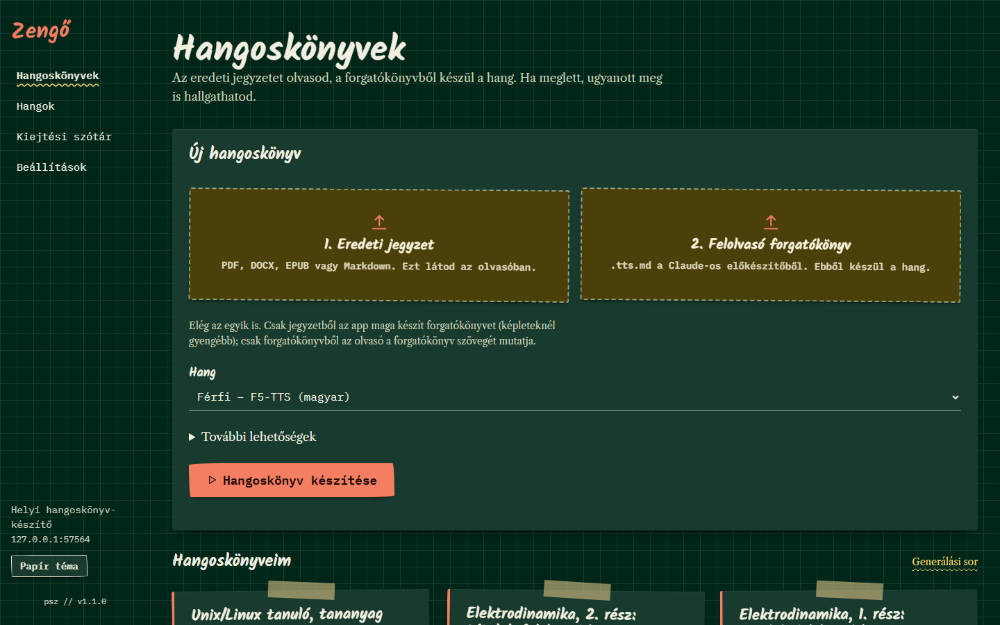
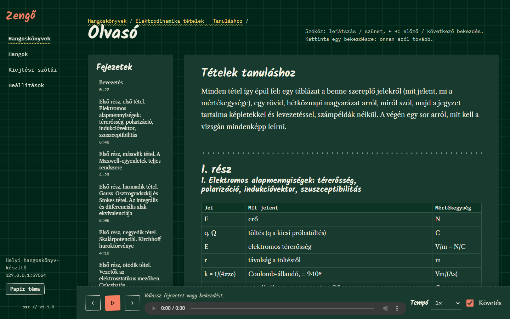
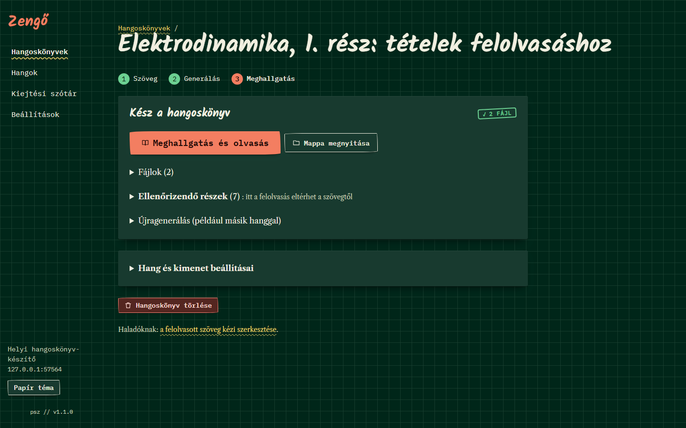
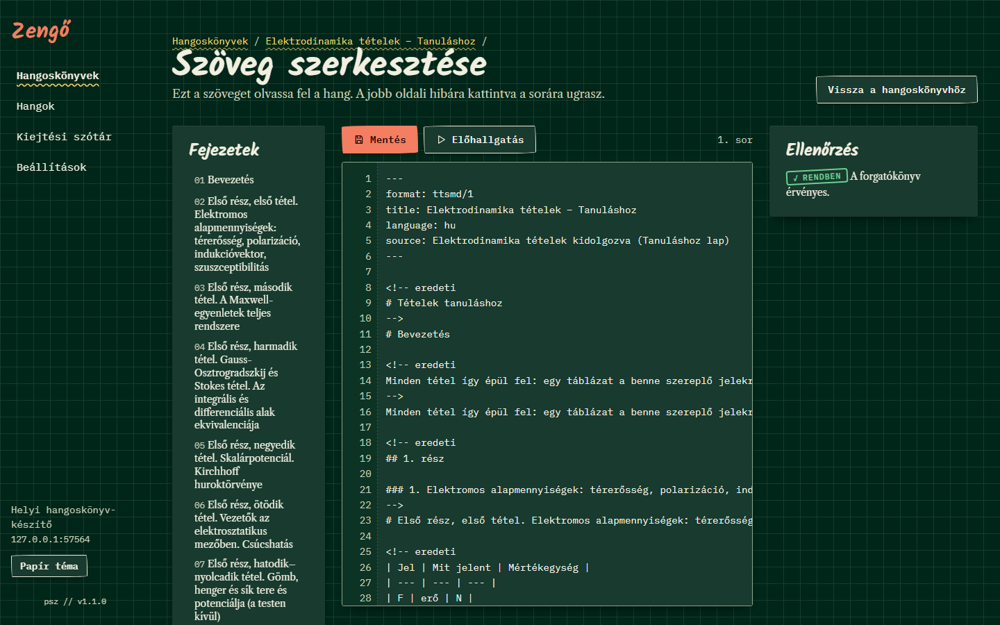
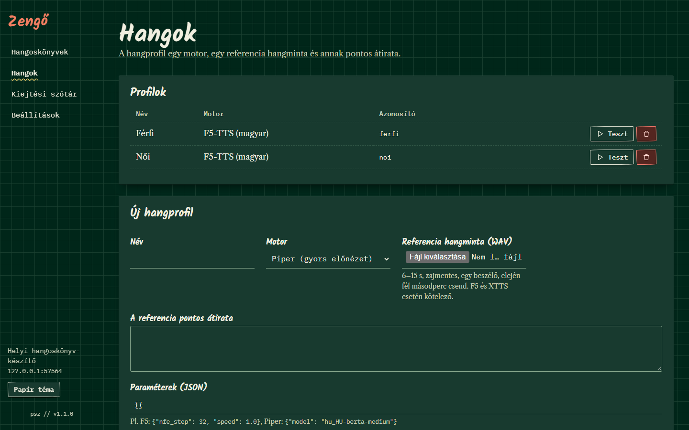
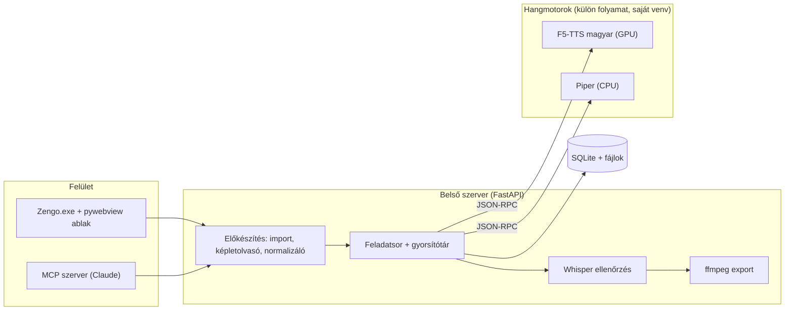

<div align="center">


# Zengő

**Képletes egyetemi jegyzetből magyar hangoskönyv, a saját gépen, internet nélkül**


[Funkciók](#funkciók) · [Képernyőképek](#képernyőképek) · [Architektúra](#architektúra) · [Telepítés](#telepítés)

</div>

> [!NOTE]
> **English summary.** Zengő is a Windows desktop app that turns Hungarian lecture notes (PDF, DOCX, EPUB, Markdown), formulas included, into chapter-marked MP3 / M4B audiobooks with a local neural voice (F5-TTS). Everything runs offline on the user's own NVIDIA GPU. A reader view highlights the paragraph being read, so the notes can be followed while listening.

<p align="center">
  
</p>

## A probléma

Vizsga előtt a jegyzetet sokszor jó lenne hallgatni is: utazás közben, séta közben, ismétlésként. A felolvasó
programok viszont a képleteket nem tudják kimondani („E = F / q” helyett betűket és jeleket mondanak), a magyar
hangjuk gépies, a felhős szolgáltatások pedig fizetősek, és a jegyzetet fel kell tölteni hozzájuk.

## A megoldás

A Zengő a jegyzetből felolvasási forgatókönyvet készít, amelyben minden képlet, szimbólum és mértékegység teljes
magyar mondatként szerepel („E egyenlő F per q”). Ebből egy magyarra finomhangolt F5-TTS modell a saját gépen
generálja a hangot, a beszédfelismerő pedig minden darabot visszaellenőriz. A kész hangoskönyvet az olvasónézetben
az eredeti jegyzettel együtt lehet hallgatni.

## Funkciók

- **Képletes anyag.** A forgatókönyvben minden képlet kimondható mondat; a `felolvaso-elokeszito` Claude skill ezt
  készíti el, de egyszerűbb szöveghez az app maga is előkészít.
- **Természetes magyar hang.** F5-TTS magyar finomhangolással, saját referenciahangból klónozott hangprofilokkal;
  mondatcsoportos generálás, a mondatvégek lecsengenek, nem vágódnak el.
- **Olvasónézet.** Az eredeti PDF vagy a kiemelt szöveg mellett szól a hang, a felolvasott bekezdés követhető,
  billentyűvel léptethető.
- **Minőségellenőrzés.** A Whisper a generált hangot visszaírja szöveggé; a gyanús részeket listázza, és egyenként
  újragenerálhatók.
- **Kiejtési szótár.** A rosszul ejtett szavak javítása után csak az érintett darabok generálódnak újra
  (gyorsítótár).
- **Export.** Fejezetenkénti MP3, vagy egy MP3 fejezetjelölőkkel, és M4B hangoskönyv.
- **Asztali app, hordozható mappa.** Saját ablak, dupla kattintással indul; a mappa átmásolható egy másik NVIDIA-s
  gépre.

## Képernyőképek

<table>
  <tr>
    <td align="center" width="50%"><br/><sub>Olvasónézet fejezetlistával és lejátszóval</sub></td>
    <td align="center" width="50%"><br/><sub>Kész hangoskönyv, ellenőrizendő részek</sub></td>
  </tr>
  <tr>
    <td align="center" width="50%"><br/><sub>Forgatókönyv szerkesztő ellenőrzéssel és előhallgatással</sub></td>
    <td align="center" width="50%"><br/><sub>Hangprofilok</sub></td>
  </tr>
</table>

## Architektúra



A `Zengo.exe` egy kis indító: a hordozható mappa helyéhez igazítja a Python környezeteket, majd ablak nélkül
elindítja az appot. Az app a belső szervert egy szabad helyi porton indítja, és a felületet a Windows beépített
WebView2 motorjával saját ablakban mutatja. A hangmotorok külön Python 3.11 + PyTorch környezetben, külön
folyamatként futnak, a fő app JSON-RPC-n vezérli őket; az ablak bezárásakor mind leáll.

## Technológiák

| Réteg | Technológia |
|---|---|
| Asztali ablak | pywebview (WebView2), C# indító |
| Belső szerver | Python 3.12, FastAPI, Jinja2, htmx |
| Felület | vanilla JS / CSS, KaTeX |
| Hangmotorok | F5-TTS (magyar finomhangolás), Piper, PyTorch CUDA |
| Ellenőrzés | faster-whisper (large-v3-turbo) |
| Tárolás, export | SQLite, ffmpeg (MP3, M4B) |
| Integráció | MCP szerver, Claude skill |

## Telepítés

Előfeltételek: Windows 11, NVIDIA kártya legalább 8 GB memóriával és friss driverrel, [uv](https://docs.astral.sh/uv/),
ffmpeg (`winget install --id Gyan.FFmpeg -e`).

1. Fejlesztői környezet, motorok és modellek (a modellek kb. 3 GB):
   ```powershell
   powershell -ExecutionPolicy Bypass -File .\setup.ps1
   ```
2. Az asztali app indítása a forrásból:
   ```powershell
   uv run zengo
   ```
3. Hordozható mappa készítése (`dist\Zengo`, kb. 12 GB, benne a `Zengo.exe`):
   ```powershell
   powershell -ExecutionPolicy Bypass -File .\scripts\build_portable.ps1
   ```
   A mappa átmásolható; első indításkor a korábbi telepítés projektjeit és hangoskönyveit magához másolja.

## Használat

1. Indítsd el a `Zengo.exe`-t.
2. **Hangoskönyvek**: húzd be az eredeti jegyzetet (ezt látod az olvasóban) és, ha van, a `.tts.md`
   forgatókönyvet (ebből készül a hang); elég az egyik is. Válassz hangot, és indítsd a generálást.
3. Ha kész, a **Meghallgatás és olvasás** gombbal nyílik az olvasónézet; a kész MP3 / M4B a `Hangoskönyvek`
   mappába kerül.

A forgatókönyv formátuma: [docs/ttsmd-format.md](docs/ttsmd-format.md); Claude-dal való használat:
[docs/mcp-setup.md](docs/mcp-setup.md).

## Mappaszerkezet

```text
.
├── app/            # belső szerver, előkészítés, feladatsor, export, felület, asztali ablak
├── engines/        # hangmotor workerek (f5, piper), mindegyik saját venv-vel
├── launcher/       # Zengo.exe indító (C#)
├── mcp_server/     # MCP szerver Claude-hoz
├── claude-skill/   # felolvasási forgatókönyvet készítő Claude skill
├── scripts/        # modellletöltés, hordozható build, segédszkriptek
├── tests/          # pytest
└── docs/           # formátumleírás, képernyőképek, logó
```

## Tervek

- [ ] A hangmotor kiürítése a videókártya memóriájából pár perc tétlenség után
- [ ] Haladásjelzés az első indításkori átköltöztetéshez
- [ ] Hangprofilok csomagolása a hordozható mappába, hogy üres gépen is azonnal legyen hang
- [ ] Telepítő és aláírt indító

## Licenc

MIT, lásd [LICENSE](LICENSE). A modellsúlyok nem részei a repónak, és a saját licencük vonatkozik rájuk
(lásd [sarpba/F5-TTS_V1_hun](https://huggingface.co/sarpba/F5-TTS_V1_hun), [SWivid/F5-TTS](https://github.com/SWivid/F5-TTS)).

---

<div align="center">
<sub>Készítette: Pintér Szabolcs · <a href="https://github.com/piszabolcs">GitHub</a> · <a href="https://www.linkedin.com/in/piszabolcs">LinkedIn</a></sub>
</div>
